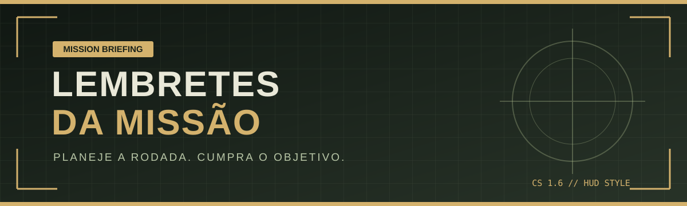

<div align="center">




<sub><code>COUNTER-STRIKE 1.6 // MISSION BRIEFING // UMFG 2026</code></sub>

**PLANEJE A RODADA. CUMPRA O OBJETIVO.**

</div>

> [!IMPORTANT]
> **MISSÃO ATIVA:** Organize seus lembretes, acompanhe suas tarefas e mantenha o objetivo sob controle. Este projeto acadêmico utiliza a estética tática clássica de Counter-Strike 1.6 como referência visual.

### 📟 PAINEL DE NAVEGAÇÃO

| Setor | Área | Acesso rápido |
|:--:|:--|:--|
| `01` | Briefing | [Sobre o projeto](#briefing) |
| `02` | Objetivos | [Recursos](#objetivos) |
| `03` | Loadout | [Tecnologias e paleta](#loadout) |
| `04` | Mapa | [Organização](#mapa) |
| `05` | Partida | [Como executar](#iniciar) |
| `06` | Rádio | [Rotas da API](#comandos) |
| `07` | Equipe | [Créditos](#creditos) |
| `08` | Intel | [Referências](#intel) |

---


O **Lembretes da Missão** é um projeto de Programação III dividido em front-end e API. A identidade visual faz referência ao clima de Counter-Strike 1.6 — paleta tática, elementos de HUD e linguagem de missão — enquanto a aplicação permite cadastrar, consultar e organizar lembretes.

<a id="objetivos"></a>
## 🎯 02 // OBJETIVOS DA RODADA

- 📝 Criar, editar e excluir lembretes.
- 🔎 Filtrar por texto, data de cadastro e data de atualização.
- ↕️ Ordenar e paginar os resultados.
- 🖨️ Gerar e baixar um relatório em PDF.
- 🎮 Interface responsiva inspirada em jogos táticos clássicos.

<a id="loadout"></a>
## 🛠️ 03 // EQUIPAMENTOS DO LOADOUT

| Camada | Tecnologias |
|---|---|
| Front-end | HTML, CSS e JavaScript |
| API | ASP.NET Core Minimal API, .NET 8 e Entity Framework Core |
| Banco de dados | MySQL |
| Relatório PDF | QuestPDF |

### 🎨 PALETA TÁTICA // HUD COLOR PROFILE

| Elemento da interface | Cor | Código |
|:--|:--|:--|
| Fundo principal | ⚫ Preto operacional | `#101712` |
| Painéis e superfícies | 🟩 Verde-chumbo | `#283328` |
| Destaques e alertas | 🟨 Areia / dourado | `#D4B26D` |
| Indicadores de status | 🟢 Verde militar | `#72835B` |
| Texto principal | ⚪ Branco-acinzentado | `#E9E8D8` |

<a id="mapa"></a>
## 🗂️ 04 // MAPA DE ARQUIVOS

```text
lembretes-da-missao/
├── backend/
│   ├── umfg.programacaoiii.minimalapi.2026.sln
│   └── umfg.programacaoiii.minimalapi.2026/
│       ├── Contexto/
│       ├── DTO/
│       ├── Entidades/
│       ├── Migrations/
│       ├── Properties/
│       ├── Program.cs
│       └── *.csproj
├── frontend/
│   ├── css/
│   ├── js/
│   └── index.html
├── .gitignore
└── README.md
```

<a id="iniciar"></a>
## 🟢 05 // INICIAR PARTIDA

São necessários o **.NET 8 SDK**, o **MySQL** e o **Visual Studio Code** com a extensão **Live Server**. A API usa a variável de ambiente `ConnectionString`; não salve nem publique credenciais no código.

### 1. Inicie o MySQL e a API

Na raiz do repositório, abra um terminal PowerShell:

```powershell
cd "backend\umfg.programacaoiii.minimalapi.2026"
$env:ASPNETCORE_ENVIRONMENT = "Development"
$usuario = Read-Host "Usuário do MySQL local"
$senhaSegura = Read-Host "Senha do seu MySQL local" -AsSecureString
$ptr = [Runtime.InteropServices.Marshal]::SecureStringToBSTR($senhaSegura)
try {
    $senha = [Runtime.InteropServices.Marshal]::PtrToStringBSTR($ptr)
    $env:ConnectionString = "Server=localhost;Port=3306;Database=umfg_lembrete_develop;Uid=$usuario;Pwd=$senha;"
}
finally {
    [Runtime.InteropServices.Marshal]::ZeroFreeBSTR($ptr)
    Remove-Variable senha, senhaSegura, usuario -ErrorAction SilentlyContinue
}
dotnet dev-certs https --trust
dotnet run --launch-profile https
```

Informe as credenciais do seu próprio MySQL quando solicitadas. A senha é pedida sem aparecer na tela e a connection string existe apenas como variável de ambiente da sessão atual: não a grave em arquivos, não a compartilhe e nunca a envie ao GitHub. Fechar o terminal encerra essa configuração local. Mantenha-o aberto enquanto usa a API, que ficará disponível em `https://localhost:7063` e `http://localhost:5207`.

O banco MySQL precisa estar ativo e acessível com as credenciais informadas. O contexto da API aplica as migrations pendentes ao conectar-se ao banco. Os arquivos `appsettings.Development.json`, `appsettings.Production.json` e `appsettings.UMFG.json` são locais e estão excluídos do Git para evitar publicar configurações específicas de cada máquina.

### 2. Inicie o front-end

Em outro terminal, na raiz do repositório:

```powershell
cd frontend
```

Abra `frontend/index.html` com **Live Server** no VS Code (botão **Go Live**). O front-end está configurado para acessar `https://localhost:7063`.

> Se mudar a porta HTTPS da API, atualize `API_URL` em `frontend/js/app.js`. Se aparecer um aviso de certificado, confirme a confiança do certificado de desenvolvimento com `dotnet dev-certs https --trust`.

<a id="comandos"></a>
## 📡 06 // COMANDOS DA API

| Método | Rota | Ação |
|---|---|---|
| `GET` | `/lembretes/filtro` | Filtra, ordena e pagina lembretes |
| `POST` | `/lembretes` | Cria um lembrete |
| `GET` | `/lembretes/{id}` | Consulta um lembrete |
| `PUT` | `/lembretes/{id}` | Atualiza a descrição |
| `DELETE` | `/lembretes/{id}` | Desativa um lembrete |
| `GET` | `/lembretes/imprimir` | Gera relatório em PDF |

<a id="creditos"></a>
## 🏅 07 // CRÉDITOS ACADÊMICOS

- **Estudante responsável:** Felps.
- **Disciplina:** Programação III — Front-end.
- **Instituição:** UMFG.
- **Ano letivo:** 2026.

Este é um projeto acadêmico independente, sem associação, patrocínio ou aprovação da Valve. **Counter-Strike**, **Counter-Strike 1.6** e as marcas relacionadas pertencem aos respectivos titulares. O jogo é citado como referência temática; este repositório não é um produto oficial da Valve.

<a id="intel"></a>
## 🔗 08 // INTEL & REFERÊNCIAS

- [Counter-Strike na Steam](https://store.steampowered.com/app/10/CounterStrike/) — página oficial do jogo.
- [Valve](https://www.valvesoftware.com/) — site oficial da empresa.
- [Documentação do .NET](https://learn.microsoft.com/dotnet/).
- [Documentação do MySQL](https://dev.mysql.com/doc/).
- [QuestPDF](https://www.questpdf.com/) — biblioteca utilizada para gerar relatórios.
- [Google Fonts](https://fonts.google.com/) — fontes usadas na interface.
- Fontes incluídas na API: Barlow e Cinzel, com arquivos de licença OFL no diretório `backend/umfg.programacaoiii.minimalapi.2026/Fontes/`.

---

<div align="center">

**Comunique, planeje e jogue pelo objetivo.**  
*Projeto acadêmico — não oficial e sem vínculo com a Valve.*

</div>
